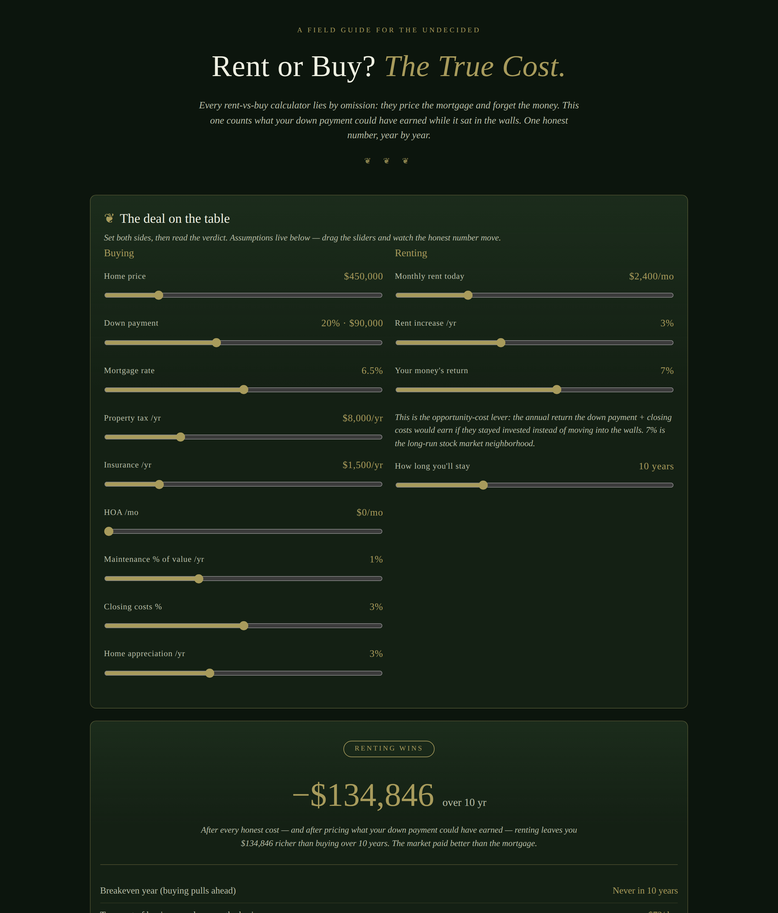

# Rent or Buy? — The True Cost

**Live:** https://thebullbrew.github.io/rent-or-buy-true-cost/

## What it does

Every rent-vs-buy calculator lies by omission: they price the mortgage and forget the money. This one puts the down payment's **opportunity cost** on the scale — the returns that cash would have earned if it stayed invested instead of moving into the walls.

Set the buying side (price, down payment, rate, taxes, insurance, HOA, maintenance, closing costs, appreciation) and the renting side (rent, rent inflation, your money's investment return, how long you'll stay), and get one honest number: **the net-wealth advantage of buying over renting, year by year** — plus the breakeven year, true cost-per-day on both sides, and the dollar figure of your down payment's missed earnings.

## The method

- **Wealth math, not cash-flow math.** Buying can win on net worth while feeling tighter month to month. The chart shows the trade honestly: cumulative wealth advantage of buying over renting, with a zero line.
- **Principal paydown counts as savings**, not cost. Appreciation counts. Closing costs and a 6% sell-side cut count as sunk.
- **Opportunity cost is priced in:** the renter's down payment + closing costs compound at your chosen return for the full horizon.
- **Breakeven year** = the first year buying pulls ahead even if you sold that year (realtor cut included).
- Scenarios save to localStorage; one tap copies a plain-text summary.

## How to run

It's a static single-page app — no build, no backend, no keys.

- **Online:** open the live link above.
- **Offline:** open `docs/index.html` in any browser (works from `file://`).
- **Installable:** it ships a minimal PWA shell (`manifest.webmanifest` + `sw.js`) — add it to your home screen and it works offline.

Dark old-money aesthetic: **Forest Tithe** (variation 14) — deep forest greens, moss-gold accents, botanical ornaments.

Part of Bull's daily app series — one useful finance or real-estate tool every day.
